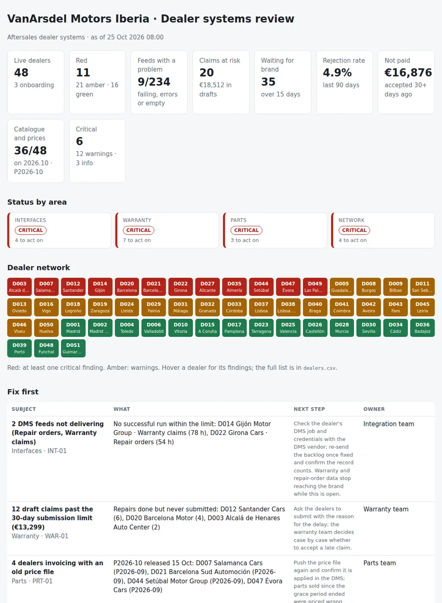

# Dealer Systems Health

The weekly review of the systems a car brand's dealer network depends on, built from the network's own exports. It covers four areas:

- **DMS interfaces:** feeds that stopped, feeds rejecting records, and feeds that succeed with nothing in them.
- **Warranty claims:** drafts about to miss the submission limit, the brand's own backlog, unanswered information requests, rejection rates and their reasons, possible duplicates, and accepted claims nobody paid.
- **Parts:** the parts catalogue and price file each dealer is actually using.
- **Dealer network:** DMS versions out of certification, dealers opening with the checklist half done, and dealers that left but are still connected.

Five CSVs, one JSON with the rules and one Python command produce a red/amber/green view of every dealer and the agenda for the weekly call: **what is broken, at which dealer, and who fixes it.**

Python 3.10+, standard library only. It runs with fictional demo data out of the box. A read-only PowerShell exporter with example SQL queries for the integration log, the warranty claims and the catalogue status is included.



## Why

When a dealer's warranty feed stops on a Thursday night, nobody notices until the dealer asks on Tuesday why its claims have no answer. A DMS job that "succeeds" with zero records alerts nobody at all. A dealer on last month's parts catalogue sends labour operations the warranty system no longer accepts, so its rejection rate climbs and the conversation turns to bad claims instead of an old catalogue. A price file that did not apply means a week of parts sold at the wrong price. And the dealer that closed in September still has working interface credentials.

Each of these lives in a different system: the integration log, the warranty system, the parts distribution and the network register. The weekly review needs them side by side, per dealer, with the rule that flagged each line and the team that owns the fix. This tool puts them together. The rules are in `settings.json` and `dealerhealth/checks.py`.

## What it checks

| Area | Code | Finding |
|---|---|---|
| Interfaces | INT-01 | No successful run within `stale_hours`; critical for repair orders and warranty claims |
| Interfaces | INT-02 | More than `error_rate_max_pct` of records rejected over `window_days` |
| Interfaces | INT-03 | Runs that succeed but carry 0 records for `silent_days` |
| Interfaces | INT-04 | Expected feeds with no runs at all (for information) |
| Warranty | WAR-01 | Draft claims past `claim_submit_days` after the repair date |
| Warranty | WAR-02 | Draft claims due within `claim_warn_days` |
| Warranty | WAR-03 | Submitted claims waiting for the brand over `claim_pending_days` |
| Warranty | WAR-04 | Information requested and not answered in `info_request_days` |
| Warranty | WAR-05 | Dealers with a rejection rate above `rejection_rate_max_pct`, with the main reasons |
| Warranty | WAR-06 | Same VIN and labour operation claimed twice within `duplicate_window_days` |
| Warranty | WAR-07 | Accepted claims not paid after `unpaid_days` |
| Parts | PRT-01 | Price file not applied after `price_grace_days` |
| Parts | PRT-02 | Parts catalogue two or more versions behind |
| Parts | PRT-03 | Previous catalogue after `catalogue_grace_days` |
| Parts | PRT-04 | Dealers with no catalogue status (for information) |
| Network | NET-01 | DMS version not certified for the brand interfaces |
| Network | NET-02 | DMS version leaving support within `eos_warn_days` (for information) |
| Network | NET-03 | Onboarding checklist items still open close to the go-live date |
| Network | NET-04 | Terminated dealers still sending interface runs or claims |

## Outputs

| File | What |
|---|---|
| `report.html` | Tiles, status by area, the dealer network as a red/amber/green grid, "Fix first", feeds with a problem per dealer, warranty queues, rejection rate by dealer, catalogue and price file, dealers onboarding, all findings |
| `dealer-review.md` | The agenda: summary, decisions as a checklist with owners, items for information, top rejection reasons, red dealers with their area manager |
| `dealers.csv` | Every dealer with its feeds, rejection rate, catalogue, price file, RAG status and findings |
| `interfaces.csv` | Every dealer and feed: last success, runs, failed runs, records, errors, empty days, verdict |
| `claims-at-risk.csv` | The claims in each queue (past the limit, due soon, waiting for the brand, information requested, unpaid, possible duplicates) and who they wait on |
| `rejections.csv` | Rejection rate per dealer with the main reasons |
| `catalogue.csv` | Catalogue and price file per dealer with the verdict |
| `actions.csv`, `findings.csv` | The findings with owner and next step, ready for a tracker |

## Try it

```bash
git clone https://github.com/inigogonzalezgarcia/31-dealer-systems-health.git
cd 31-dealer-systems-health
python -m dealerhealth demo
```

Open `output/report.html` and `output/dealer-review.md`.

### The demo data

The demo is a made-up car importer, VanArsdel Motors Iberia, with 53 dealers in Spain and Portugal: 48 live, 3 onboarding and 2 terminated. The DMS products are fictional too (DriveLedger, GarageOne, MotorDesk). The data covers two weeks of interface runs (234 feeds) and five months of warranty claims (about 4,600), reviewed on Sunday 25 October 2026 at 08:00.

The problems are placed on purpose:

- **Interfaces:** one dealer's warranty feed has failed for three nights and another's repair-order feed for two. A parts-order feed is down. One stock feed rejects nearly a fifth of its records, and the parts orders of the three dealers on the oldest GarageOne version reject about 7%. One vehicle-sales feed has succeeded with nothing in it for a week.
- **Warranty:**
  - 12 drafts past the 30-day limit at three dealers and 8 more due this week;
  - 35 claims waiting for the brand for up to 41 days, most of them battery and charging claims parked in technical review;
  - one dealer sitting on 9 information requests;
  - two dealers above the rejection limit, one of them because of an old catalogue and the other because of missing photos;
  - 4 possible duplicates;
  - one dealer whose accepted claims have not been paid since its bank details changed.
- **Parts:** four dealers still invoicing with last month's price file, two dealers two catalogue versions behind, five on the previous catalogue, one with no status.
- **Network:** 7 dealers on an uncertified DMS version. One dealer opens in five days with interface testing and warranty training still open, and another opens in fifteen days with three items open. A dealer terminated on 30 September still sends data every night.

## Use it with your own network

1. Adapt the three queries in `scripts/queries/` to your integration log, warranty system and parts distribution (one-time). Then export:
   ```powershell
   .\scripts\Export-DealerData.ps1 -ServerInstance sql-dealer01\INTEGRATION -Database DealerHub -OutputFolder .\data
   ```
   - The script only runs single SELECT statements: it refuses anything else and stores no credentials.
   - If your systems export CSV directly, use those files instead: the column names are matched loosely.
2. Add `dealers.csv` and `onboarding.csv` from the network register.
3. Write `data/settings.json`: the current catalogue and price file, certified DMS versions, the claim limits agreed with the warranty team, and the owners ([docs/data-format.md](docs/data-format.md)).
4. Build the outputs:
   ```bash
   python -m dealerhealth review data/ --title "Dealer systems review · week 44"
   ```

[docs/dealer-review-runbook.md](docs/dealer-review-runbook.md) has the 40-minute agenda, how to read each signal and what to do after the meeting.

The exports contain dealer and vehicle data. Keep them inside your organisation:

- real files at the top level (`dealers*.csv`, `interface_runs*.csv`, `warranty_claims*.csv`, `catalogue_status*.csv`, `onboarding*.csv`, `settings.json`, `data/`) and the `output/` folder are excluded from Git by `.gitignore`;
- only the fictional files in `sample_data/` are committed.

## Tests

```bash
pip install -r requirements-dev.txt
python -m pytest -q
```

GitHub Actions runs them on Python 3.10 and 3.12 on every push, then rebuilds the fictional sample data and the report screenshot from the simulator.

15 tests: register, run-log and claim exports with other column names, accents, semicolons and decimal commas; settings; interface verdicts (healthy, one failed night, rejected records, empty runs, no data); the warranty queues and their clocks; duplicates; rejection rates with a minimum number of decisions; catalogue and price-file verdicts; DMS certification, onboarding and terminated dealers; and the demo end to end (deterministic, all nine outputs).

## Next steps

- Read the integration log from the platform's API instead of SQL, so the review can run daily.
- Rejected interface records grouped by error code, to show which master data each dealer is missing.
- A dealer-facing one-page extract, so each dealer receives its own list in its own language.
- Warranty parts returns: parts requested back for inspection and not received.

## Background

Built from my work with dealer management systems (DMS) and dealer networks, warranty claim management and aftersales parts catalogues. It also draws on:

- integrations and vendor management;
- SLAs and OLAs defined and followed;
- process ownership for incidents, changes and problems.

Written from scratch with fictional data; no employer data, systems or exports are used.

## Customisation and contact

Want this adapted to your network? For example:

- your DMS products and the interfaces your brand actually uses;
- your warranty rules (submission limits, parts returns, goodwill);
- an extract per dealer or per area manager;
- the review written into your service desk or tracker each week.

Get in touch:

- Website (contact form): [inigogonzalezgarcia.github.io](https://inigogonzalezgarcia.github.io/about.html#contacto)
- LinkedIn: [linkedin.com/in/igonzalez93](https://www.linkedin.com/in/igonzalez93)

## License

MIT
